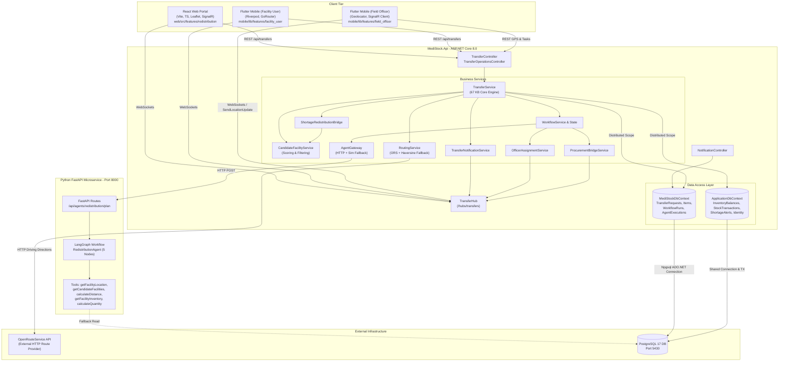
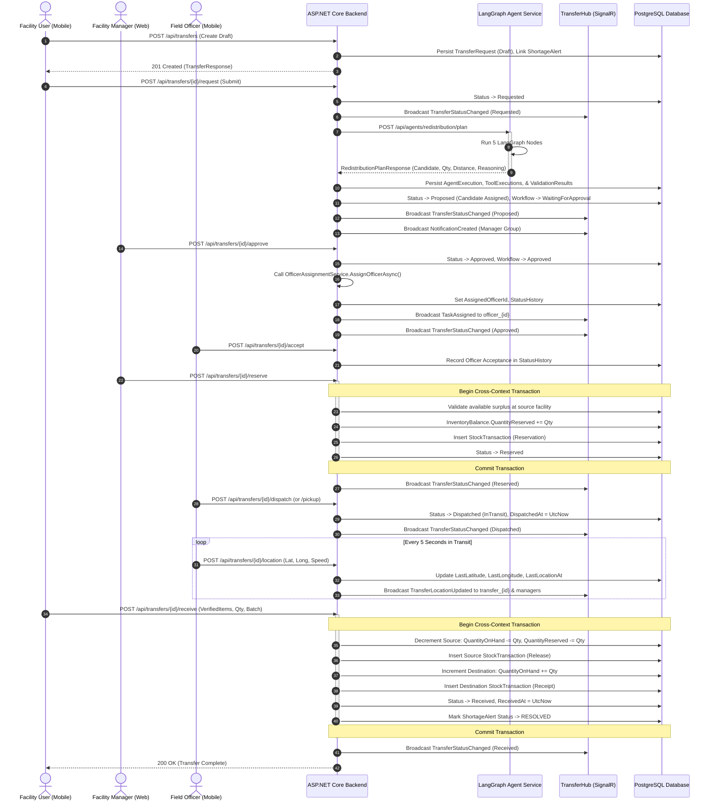
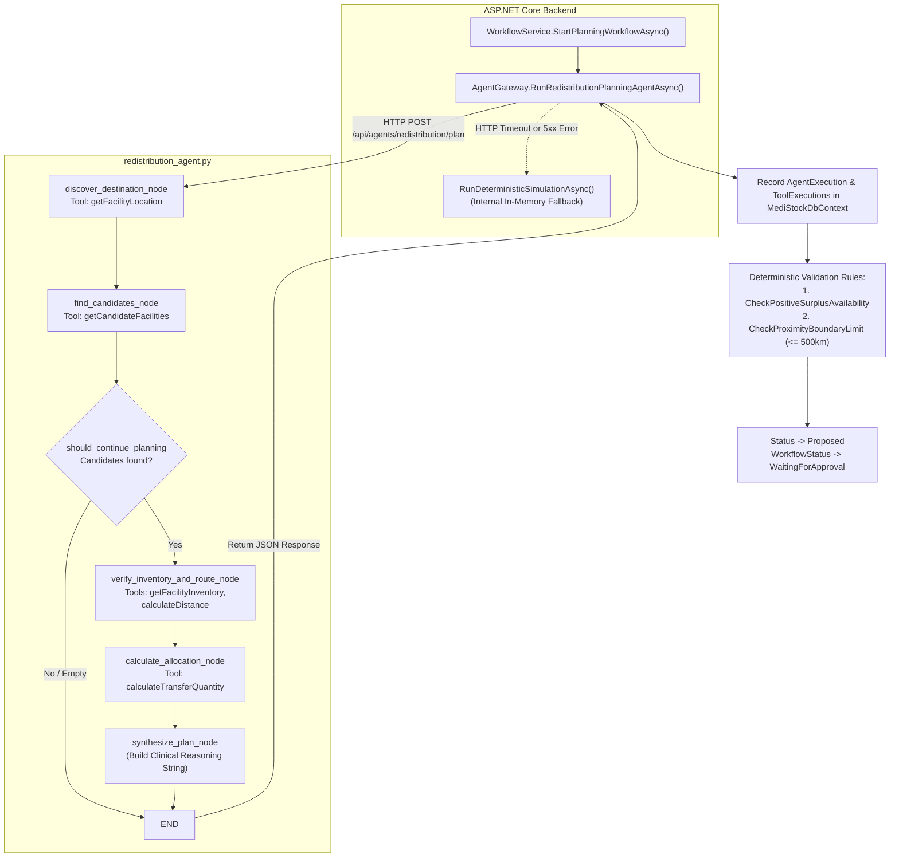

# REDISTRIBUTION INTEGRATION HANDOFF: COMPLETE TECHNICAL AND ARCHITECTURAL SPECIFICATION

> **Authoritative Technical Handoff Document**  
> **Repository Slice:** MediStock Redistribution Management Module (Ilham / Member 3 Branch)  
> **Target Audience:** Lead Architects, Backend/Frontend/Mobile Engineers, and Antigravity Integration Agents implementing Redistribution inside the primary MediStock platform.  
> **Specification Version:** 1.0.0 (Production Verified Baseline)  
> **Timestamp:** 2026-10-16  

---

## 1. Purpose and Scope

### 1.1 Purpose
This document provides an exhaustive, evidence-backed architectural and technical handoff of the **Redistribution Management Module** developed within this repository slice. It is specifically designed to allow an autonomous Antigravity software agent or human engineering team working on the independent, primary MediStock platform to integrate, adapt, or recreate the redistribution subsystem without requiring manual codebase re-inspection.

### 1.2 Scope
This specification encompasses:
1. **The Backend ASP.NET Core API (`backend/src/MediStock.Api`)**: Controllers, application services, domain models, entity mappings, validators, transactional state transitions, and SignalR real-time hubs.
2. **The Python AI Agent Microservice (`agent-service/src/medistock_agents`)**: The LangGraph stateful redistribution planning agent, tool definitions, scoring algorithms, and routing heuristics.
3. **The Web Management Application (`web/src/features/redistribution`)**: React 18, TypeScript, TanStack Query, SignalR hooks, interactive routing maps, and human-in-the-loop approval panels.
4. **The Mobile Application (`mobile/lib/features/redistribution`, `facility_user`, `field_officer`)**: Flutter Riverpod client, dual routing architecture, field officer location tracking, barcode verification, and receipt reconciliation workflows.
5. **Cross-Cutting Concerns**: Transactional boundaries, dual `DbContext` synchronization, inventory reservations, shortage alert suppression guards, audit logging, and role-based access control.

### 1.3 Operational Ground Rules for Target Integration
- **Zero Hallucination Standard:** Every claim of existing functionality is substantiated by file paths, symbol names, and exact line numbers.
- **Strict Implementation Statuses:** All features are labeled as `IMPLEMENTED`, `PARTIALLY IMPLEMENTED`, `MOCKED`, `PLANNED`, `MISSING`, or `UNVERIFIED`.
- **Target Design Isolation:** Architecture and interfaces recommended for integration into the main platform are explicitly tagged with `[TARGET DESIGN]` to distinguish them from the current repository state.
- **Single Source of Truth:** AI agents never directly mutate inventory tables; all stock mutations occur via authorized, transactional backend services.

---

## 2. Executive Summary

### 2.1 Problem Solved
In distributed healthcare networks, localized drug stockouts frequently occur simultaneously with inventory surpluses at neighboring healthcare facilities. The Redistribution Management Module automates the identification, routing, proposal, reservation, transport tracking, and receipt verification of inter-facility stock transfers. This resolves supply imbalances rapidly without incurring the delays and costs of emergency supplier procurement.

### 2.2 Implemented Capabilities
1. **AI-Driven Source Candidate Selection:** A 5-step LangGraph planning workflow evaluates candidate facilities based on net available surplus (`QuantityOnHand - MinimumStock - QuantityReserved`), physical road network transit distance, and estimated travel duration.
2. **Deterministic Fallback Engine:** If the Python agent microservice or external OpenRouteService API is unreachable, the system fails over to in-process deterministic scoring and Haversine distance calculations with an empirical 1.25 road curvature multiplier.
3. **Two-Phase Inventory Commitment:** Stock is formally reserved (`QuantityReserved` incremented) upon human manager approval, preventing double-allocation across concurrent transfer workflows. Physical balances (`QuantityOnHand`) are only decremented upon confirmed receipt at the destination facility.
4. **Real-Time Visibility:** A SignalR hub (`/hubs/transfers`) streams lifecycle status transitions, managerial approval requests, field officer task dispatches, and periodic GPS location updates (5-second cadence) to web and mobile subscribers.
5. **Procurement Escalation Bridge:** If a transfer request is rejected by a manager or cannot be satisfied due to regional stock exhaustion, the system automatically transitions the shortage into a purchase replenishment request (`ReplenishmentRequest` in status `PendingPO`) broadcasting to procurement teams.

### 2.3 Key Architectural Nuances Discovered
- **Dual DbContext Division:** The repository currently runs two database contexts against PostgreSQL: `ApplicationDbContext` (authoritative Identity, InventoryBalances, StockTransactions, Demand ShortageAlerts) and `MediStockDbContext` (TransferRequests, TransferItems, WorkflowRuns, AgentExecutions). `TransferService` bridges these via ADO.NET connection and transaction sharing.
- **Dual Flutter Routing Trees:** The mobile app contains both a legacy imperative `AppRouter` (`mobile/lib/core/routing/app_router.dart`) and a modern declarative `GoRouter` (`mobile/lib/core/router/app_router.dart`). Both resolve into the same redistribution screens.

---

## 3. Repository and Technology Baseline

### 3.1 Core Technology Stack

| Layer | Technology | Version | Location in Repository | Notes |
|---|---|---|---|---|
| **Backend API** | .NET / ASP.NET Core | 8.0.x (C# 12) | `backend/src/MediStock.Api` | Web API, Entity Framework Core 8, SignalR Hubs |
| **Backend Testing** | xUnit, FluentAssertions, Moq | 8.0 | `backend/tests/MediStock.Api.Tests` | 394 automated tests passing |
| **AI Microservice** | Python, FastAPI, LangGraph | 3.11+, LangGraph 0.2+ | `agent-service/` | Runs on port 8000; stateful DAG execution |
| **Agent Testing** | Pytest, Asyncio | Pytest 8.x | `agent-service/tests/` | 11 unit & golden workflow suites |
| **Web Portal** | React, TypeScript, Vite | React 18.3, Vite 5.x | `web/` | TailwindCSS, TanStack Query v5, Leaflet |
| **Web Testing** | Vitest, React Testing Library | 1.x | `web/src/test/` | 170 unit tests passing |
| **Mobile App** | Flutter / Dart | Flutter 3.22+, Dart 3.4+ | `mobile/` | Riverpod 2.x, GoRouter, Geolocator, FlutterMap |
| **Mobile Testing** | flutter_test | Dart SDK | `mobile/test/` | 90 unit & widget tests passing |
| **Database** | PostgreSQL | 17-alpine | Docker container `medistock-postgres` | Port 5430 (mapped from 5432) |
| **Containerization**| Docker Compose | v2 schema | `compose.yaml` | 4 microservices: postgres, backend, agent, web |

### 3.2 Service Boundaries and Network Ports

```
┌────────────────────────────────────────────────────────────────────────┐
│                        DOCKER COMPOSE NETWORK                          │
│                                                                        │
│   [ web ] (Port 5173:80)                                               │
│     │                                                                  │
│     ▼ HTTP REST & SignalR WebSockets                                   │
│   [ backend ] (Port 5050:8080)                                         │
│     │                    │                                             │
│     │ ADO.NET / Npgsql   │ Internal HTTP REST                          │
│     ▼                    ▼                                             │
│   [ postgres ] (5430)  [ agent-service ] (Port 8000:8000)             │
│                          │                                             │
│                          │ Direct DB & API Client                      │
│                          └───────────────────────────────┐             │
│                                                          ▼             │
│   [ mobile (Flutter) ] ─── HTTP REST / SignalR ───► [ backend ]       │
└────────────────────────────────────────────────────────────────────────┘
```

---

## 4. Implementation Status Matrix

The following table documents the granular implementation status across all redistribution functional areas:

| Area | Feature / Capability | Key Files & Primary Symbols | Status | Upstream / Downstream Dependencies | Integration Assessment |
|---|---|---|---|---|---|
| **API** | Transfer CRUD & Filtering | `TransferController.cs:28-81`<br>`TransferService.cs:58-253` | **IMPLEMENTED** | `MediStockDbContext.TransferRequests` | Fully functional; handles pagination, search, status filtering. |
| **API** | Transfer Submission & AI Trigger | `TransferController.cs:86-104`<br>`TransferService.cs:255-430` | **IMPLEMENTED** | `WorkflowService`, `AgentGateway` | Triggers LangGraph planning; auto-links `WorkflowRunId`. |
| **API** | Source Stock Reservation | `TransferController.cs:109-131`<br>`TransferService.cs:432-582` | **IMPLEMENTED** | `ApplicationDbContext.InventoryBalances` | Atomic two-phase commit over DB connection; updates `QuantityReserved`. |
| **API** | Dispatch & Carrier Tracking | `TransferController.cs:134-160`<br>`TransferService.cs:584-644` | **IMPLEMENTED** | `TransferValidator`, `TransferNotificationService` | Transitions status to `Dispatched` (alias `InTransit`); emits SignalR. |
| **API** | Delivery Confirmation & Receipt | `TransferController.cs:188-214`<br>`TransferService.cs:646-833` | **IMPLEMENTED** | `ApplicationDbContext.InventoryBalances` | Decrements source stock, increments destination stock, logs transactions. |
| **API** | Live Location Ingestion | `TransferController.cs:253-276`<br>`TransferService.cs:1200-1250` | **IMPLEMENTED** | `ITransferHubClient.TransferLocationUpdated` | Ingests lat/long; updates entity and broadcasts to SignalR groups. |
| **API** | Officer Task Acceptance / Decline | `TransferController.cs:279-310`<br>`TransferService.cs:1252-1320` | **IMPLEMENTED** | `TransferStatusHistory`, SignalR | Officer can accept or reject assignment with audit reason. |
| **AI** | LangGraph Planning Graph | `redistribution_agent.py:217-248` | **IMPLEMENTED** | `START -> discover -> candidates -> route -> allocate -> synthesize -> END` | Python microservice executing a 5-node state graph. |
| **AI** | Candidate Surplus Evaluation Tool | `redistribution_tools.py:90-180` | **IMPLEMENTED** | Direct PostgreSQL query & fallback cache | Filters `QuantityOnHand - MinStock - Reserved > 0`. |
| **AI** | Road Distance Routing Tool | `redistribution_tools.py:182-240`<br>`RoutingService.cs:48-153` | **IMPLEMENTED** | OpenRouteService API + Haversine fallback | Computes road kilometers and estimated minutes at 45 km/h. |
| **AI** | Agent Coordinator Routing Policy | `routing_policy.py:28-60` | **PARTIALLY IMPLEMENTED** | Regex intent classification | Classifies `SHORTAGE_RESOLUTION` and selects `(DEMAND, REDISTRIBUTION, PROCUREMENT)`. |
| **AI** | Shared Coordinator Delegation Endpoint | `routes.py:193-208` | **PLANNED** | Dedicated `/coordinator-task` endpoint | Exists for Procurement; Redistribution currently exposes `/api/agents/redistribution/plan`. |
| **Web** | Transfer Pipeline Dashboard | `TransferDashboard.tsx:1-350` | **IMPLEMENTED** | `useTransfers`, `useTransferSummary` | Kanban / table view showing active transfers by pipeline stage. |
| **Web** | Transfer Detail & Approval Actions | `TransferDetail.tsx:1-750` | **IMPLEMENTED** | `useTransfer`, `useTransferMutation` | Full inspection of route, candidate surplus, and approve/reject controls. |
| **Web** | Candidate Facilities Inspection | `CandidateFacilities.tsx:1-260` | **IMPLEMENTED** | `useCandidates` | Inspects candidate surplus, expiry dates, distance, and rank score. |
| **Web** | Interactive Route & Live Tracking Map | `TransferLiveMap.tsx:1-280`<br>`RouteMap.tsx:1-120` | **IMPLEMENTED** | Leaflet, OpenStreetMap tiles | Displays source, destination, routing polyline, and real-time vehicle marker. |
| **Web** | In-App Notification Center | `NotificationBell.tsx:1-240` | **IMPLEMENTED** | `useTransferSignalR`, `/api/notifications` | Toast popups and unread drawer synchronized via SignalR. |
| **Mobile** | Facility User Request Wizard | `new_request_wizard.dart:1-480` | **IMPLEMENTED** | Riverpod `transferApiServiceProvider` | Step-by-step form to request stock based on shortages. |
| **Mobile** | Facility Receipt Verification | `receive_transfer_screen.dart:1-420` | **IMPLEMENTED** | `transfer_api_service.dart:receiveTransfer` | Item-by-item verification, damaged/missing discrepancy capture. |
| **Mobile** | Officer Live GPS Publisher | `transfer_location_service.dart:1-142`<br>`location_publisher.dart:1-68` | **IMPLEMENTED** | Geolocator, SignalR / HTTP endpoint | 5-second periodic GPS publisher active during `InTransit` state. |
| **Mobile** | Officer Incoming Task Modal | `incoming_task_modal.dart:1-180` | **IMPLEMENTED** | `TransferSignalRService.onTaskAssigned` | Pops up when task is assigned; allows Accept or Decline. |
| **Database**| Cross-Context Distributed TX | `TransferService.cs:462-474` | **IMPLEMENTED** | `NpgsqlTransaction`, `UseTransactionAsync` | Shares underlying physical DB connection across distinct contexts. |
| **Shortage**| Shortage Transfer Handoff | `ShortageRedistributionBridge.cs:20-60` | **IMPLEMENTED** | `ShortageAlertStatuses.RedistributionRequested` | Links `ShortageAlert.RelatedTransferId` upon transfer creation. |
| **Shortage**| Shortage Dismiss Guard | `ShortageService.cs:380-420`<br>`20261016110152_AddShortageDismissFields.cs` | **IMPLEMENTED** | `StockWorsened` / `RiskWorsened` checks | Prevents re-creating dismissed shortages unless inventory deteriorates. |
| **Procure** | Fallback Replenishment Request | `ProcurementBridgeService.cs:32-91` | **IMPLEMENTED** | `ReplenishmentRequest`, SignalR `procurement` group | Broadcasts PO request when transfer is rejected or cannot fulfill deficit. |

---

## 5. Actual Architecture and Mermaid Diagrams

### 5.1 Diagram 1: Actual Implementation Architecture
The current architecture consists of a dual-framework presentation tier, a monolithic .NET API host managing two EF Core database contexts, an isolated Python LangGraph agent service, and a PostgreSQL database.



---

### 5.2 Diagram 2: Complete Request-to-Delivery Sequence
Traces the full lifecycle across all actors, business rules, transactional stock reservations, and inventory reconciliation.



---

### 5.3 Diagram 3: Agent Planning Execution Flow
Illustrates the exact internal structure of the Python LangGraph redistribution agent and its fallback interaction with the .NET `AgentGateway`.



---

### 5.4 Diagram 4: Target Integration Architecture (Shared Platform Adapter)
`[TARGET DESIGN]`  
This diagram illustrates how the Redistribution module must integrate into the main MediStock platform by acting as a specialist capability under the existing shared **AI Coordinator Agent**, reusing the primary platform's shared application shell, authentication middleware, and authoritative single `ApplicationDbContext`.

```mermaid
graph TB
    subgraph Main MediStock Platform
        User["User Interface<br/>(Web Shell / Mobile Shell)"]
        Coord["Existing Shared AI Coordinator Agent<br/>(Conversation & Intent Router)"]
        AuthMid["Shared Authentication & Role Policies"]
        SharedDB[("Authoritative Main Database<br/>(Single Unified ApplicationDbContext)")]
    end

    subgraph Specialist Agents
        DemandSpec["Demand & Shortage Specialist"]
        InvenSpec["Inventory Intelligence Specialist"]
        ProcurSpec["Procurement & Policy Specialist"]
        
        subgraph Redistribution Capability [Integrated Slice]
            RedistAdapter["Redistribution Specialist Adapter<br/>(Implements ICoordinatorSpecialist)"]
            RedistService["TransferService & CandidateEngine<br/>(Business Logic Engine)"]
            RedistHub["Real-Time Transfer Hub<br/>(Merged into Main SignalR Infrastructure)"]
        end
    end

    %% User Request Flow
    User -->|1. Prompt: 'Resolve Amoxicillin Shortage'| Coord
    Coord -->|2. Authorize Request| AuthMid
    Coord -->|3. Identify Need for Inter-Facility Transfer| RedistAdapter

    %% Specialist Execution
    RedistAdapter -->|4. Request Validated Stock Surplus| InvenSpec
    InvenSpec -->|5. Query Balances| SharedDB
    RedistAdapter -->|6. Calculate Optimal Transfer Plan| RedistService
    RedistService -->|7. Road Distance & Scoring| SharedDB

    %% Decision & Action
    RedistAdapter -- Transfer Viable -->|8. Structured Plan Proposal| Coord
    RedistAdapter -- Stock Deficit Across Network -->|9. Fallback Escalation| ProcurSpec
    Coord -->|10. Present Proposal to Manager UI| User

    %% Authorized Execution (Human in the Loop)
    User -->|11. Manager Approves Transfer| RedistService
    RedistService -->|12. Atomic Reserve & Dispatched| SharedDB
    RedistService -->|13. Stream Live Updates| RedistHub
    RedistHub -->|14. WebSockets to Mobile & Web| User
```

---

## 6. Complete Business Workflow

### 6.1 Management Web Application Workflow

```
[ Shortage Alert Identified / Created ]
                │
                ▼
[ Review Active Alerts on Demand Dashboard ]
                │
                ▼
[ Click 'Request Transfer' -> Navigates to Transfer Form ]
                │
                ▼
[ System Auto-Invokes AI Redistribution Agent ]
                │
                ▼
[ Review Candidate Facilities & Road Route Comparison ]
                │
                ▼
[ Manager Approves Proposal & Assigns Field Officer ]
                │
                ▼
[ System Executes Stock Reservation (QuantityReserved += Qty) ]
                │
                ▼
[ Live Transit Monitoring via Leaflet GPS Map ]
                │
                ▼
[ Destination Receipt Confirmation & Inventory Reconciliation ]
```

#### Detailed Operational Steps:
1. **Login & Role Verification:** User authenticates via `POST /api/auth/login`. Token with role `FacilityManager` or `Administrator` is stored in browser memory/local storage (`web/src/context/AuthContext.tsx:45`).
2. **Shortage Detection:** Manager views shortage alerts on `/demand/shortages`. If a critical alert exists, clicking **Initiate Transfer** opens `/transfers/new` pre-populating `medicineId`, `destinationFacilityId`, and `shortageQuantity`.
3. **Backend Persistence:** `TransferController.CreateTransfer` writes a `TransferRequest` in `Draft` status (`TransferService.cs:175-253`). `ShortageRedistributionBridge` marks the shortage alert as `REDISTRIBUTION_REQUESTED`.
4. **AI Planning Invocation:** Calling `POST /api/transfers/{id}/request` advances status to `Requested`. The backend immediately fires `WorkflowService.StartPlanningWorkflowAsync` (`WorkflowService.cs:40-194`).
5. **Agent Execution:** The Python agent (or in-process simulation) identifies facilities where `QuantityOnHand - MinimumStock - QuantityReserved > 0`, scores candidates using the 60/40 algorithm, and returns the top candidate.
6. **Proposal Review:** The transfer moves to `Proposed`. Manager reviews the candidate surplus, batch expiration date, and driving distance on `/transfers/:id`.
7. **Approval & Assignment:** Manager clicks **Approve**. `TransferOperationsController.ApproveTransfer` records the approval, transitions status to `Approved`, calls `OfficerAssignmentService` to assign a field officer, and broadcasts `TaskAssigned` over SignalR.
8. **Inventory Reservation:** Manager triggers stock reservation (`POST /api/transfers/{id}/reserve`). The backend locks the source facility balance and increments `QuantityReserved`.
9. **Dispatch & Transit Tracking:** Once the officer confirms pickup, the transfer moves to `Dispatched` (`InTransit`). Manager tracks vehicle movements on the interactive live map (`TransferLiveMap.tsx`).
10. **Delivery & Audit Closure:** When the destination facility confirms delivery, status becomes `Received`. Authoritative inventory balances update automatically, and the audit log seals the workflow run.

---

### 6.2 Flutter Facility-User Application Workflow

```
[ Facility User Logs In (JWT Scoped to Facility) ]
                     │
                     ▼
[ Open Alerts Tab -> Select 'High Risk Shortage' ]
                     │
                     ▼
[ Click 'Request Transfer' -> Launches NewRequestWizard ]
                     │
                     ▼
[ Step 1: Select Medicine | Step 2: Set Quantity & Urgency ]
                     │
                     ▼
[ Source Facility Left Unselected (AI-Assisted Source Selection) ]
                     │
                     ▼
[ Submit Request -> Backend Returns Status: 'Requested' ]
                     │
                     ▼
[ Real-Time Tracking via SignalR (Draft -> Proposed -> Reserved -> InTransit) ]
                     │
                     ▼
[ Transfer Arrives -> Open ReceiveTransferScreen ]
                     │
                     ▼
[ Enter Verified Quantity & Discrepancy Notes -> Confirm Receipt ]
                     │
                     ▼
[ Destination Inventory Balance Automatically Incremented ]
```

#### Detailed Operational Steps:
1. **Facility User Authentication:** User logs in selecting the `user` role (`mobile/lib/features/auth/presentation/login_screen.dart:42`). The session stores `facilityId` and access token.
2. **Shortage Alert View:** User navigates to `/user/alerts` (`mobile/lib/features/facility_user/alerts/alerts_screen.dart`). Active shortages for the assigned facility are displayed.
3. **Request Wizard Launch:** User selects an alert and taps **Request Transfer**, routing to `/user/requests/new` (`new_request_wizard.dart:45`).
4. **Data Input:**
   - Medicine is auto-selected from the alert context.
   - Quantity defaults to the projected deficit.
   - Source facility is deliberately omitted to allow agent optimization.
   - Urgency is set to `High` or `Critical`.
5. **Submission:** Wizard calls `TransferApiService.createTransfer` with `submit: true` (`transfer_api_service.dart:65`). Initial returned status is `Requested`.
6. **Status Monitoring:** The user tracks progress on `RequestDetailScreen` (`request_detail_screen.dart:55`). As the backend triggers planning and management approval, SignalR events update the UI stepper in real time.
7. **Arrival Verification:** When status reaches `Dispatched` (`InTransit`), the user receives a notification. Upon physical arrival, tapping **Confirm Receipt** opens `ReceiveTransferScreen` (`receive_transfer_screen.dart:20`).
8. **Discrepancy Reporting:** User inputs the physical count received. If the count is less than requested, a discrepancy reason (e.g., "Damaged in transit", "Short packed") is captured.
9. **Authoritative Stock Increment:** Submitting the receipt triggers `POST /api/transfers/{id}/receive`. Destination stock increases, source stock decreases, and status seals as `Received`.

---

### 6.3 Flutter Field-Officer Application Workflow

```
[ Field Officer Authenticated & Online ]
                   │
                   ▼
[ Receive SignalR 'TaskAssigned' Notification Event ]
                   │
                   ▼
[ Modal Appears: Display Source, Destination, Medicine, Distance ]
                   │
                   ▼
       ┌───────────┴───────────┐
       ▼                       ▼
 [ Accept Task ]         [ Decline Task (Enter Reason) ]
       │                       │
       │                       ▼
       │             [ Task Reassigned / Escalated ]
       ▼
[ Navigate to Source Depot & Confirm Stock Pickup ]
       │
       ▼
[ Status Transitions to 'InTransit' ]
       │
       ▼
[ Background GPS Publisher Starts (Every 5s to /api/transfers/{id}/location) ]
       │
       ▼
[ Arrive at Destination Facility -> Confirm Physical Delivery ]
       │
       ▼
[ GPS Publisher Stops -> Task Moved to Officer Task History ]
```

#### Detailed Operational Steps:
1. **Officer Standby:** Officer logs into `/officer/dashboard` (`mobile/lib/features/field_officer/dashboard/officer_home_screen.dart:35`). SignalR connects and joins `officer_{officerId}`.
2. **Assignment Notification:** Backend calls `OfficerAssignmentService.AssignOfficerAsync`, which emits `ITransferHubClient.TaskAssigned`.
3. **Incoming Task Modal:** The app intercepts the event and pops `IncomingTaskModal` (`incoming_task_modal.dart:45`), displaying pickup depot, destination hospital, cargo volume, and total driving kilometers.
4. **Acceptance / Decline:**
   - **Accept:** Calls `POST /api/transfers/{id}/accept`. Officer is locked to the transfer.
   - **Decline:** Calls `POST /api/transfers/{id}/decline` with an explanation. Backend resets assignment and alerts management.
5. **Confirm Pickup:** Upon arriving at the source depot, officer inspects goods and taps **Confirm Pickup** (`active_delivery_screen.dart:120`), sending `POST /api/transfers/{id}/pickup`. Status updates to `Dispatched` (`InTransit`).
6. **Live GPS Streaming:** `TransferLocationService` (`transfer_location_service.dart:79`) checks location permissions and starts a 5-second periodic timer querying `Geolocator.getCurrentPosition(desiredAccuracy: LocationAccuracy.high)`. Coordinates are posted to `POST /api/transfers/{id}/location`.
7. **Delivery Handover:** Upon arrival at destination, officer taps **Complete Delivery**. The screen prompts the destination staff to complete the receipt verification.
8. **Shutdown:** Once received, the GPS timer cancels, tracking status transitions to `stopped`, and the task is moved to `TaskHistoryScreen` (`task_history_screen.dart`).

---

## 7. Web Application Integration Map

### 7.1 Web Screens and Component Inventory

| Screen / Component | Route | File Path | Target Role | Data Sources | User Actions | Backend Endpoints | Status |
|---|---|---|---|---|---|---|---|
| **Transfer Dashboard** | `/transfers` | `web/src/features/redistribution/TransferDashboard.tsx` | FacilityManager, Admin | `useTransfers`, `useTransferSummary` | Filter by status, search transfer number, click item for details | `GET /api/transfers`<br>`GET /api/transfers/summary` | **IMPLEMENTED** |
| **Transfer Detail** | `/transfers/:id` | `web/src/features/redistribution/TransferDetail.tsx` | FacilityManager, Admin | `useTransfer`, `useCandidates`, `useRoute` | Approve, Reject, Reserve, Dispatch, Deliver, Cancel | `GET /api/transfers/{id}`<br>`POST /api/transfers/{id}/approve`<br>`POST /api/transfers/{id}/reject`<br>`POST /api/transfers/{id}/reserve` | **IMPLEMENTED** |
| **Candidate Facilities** | `/transfers/:id/candidates` | `web/src/features/redistribution/CandidateFacilities.tsx` | FacilityManager, Admin | `useCandidates` | Inspect surplus breakdown, select alternative source facility | `GET /api/transfers/{id}/candidates`<br>`POST /api/transfers/{id}/propose` | **IMPLEMENTED** |
| **Route Comparison** | `/transfers/:id/route` | `web/src/features/redistribution/RouteComparison.tsx` | FacilityManager, Admin | `useRoute` | Compare transit duration, inspect road polyline | `GET /api/transfers/{id}/route` | **IMPLEMENTED** |
| **Transfer History** | `/history` | `web/src/features/redistribution/TransferHistory.tsx` | All Roles | `useTransfers(status=Delivered)` | View completed transfer logs, filter by date | `GET /api/transfers?status=Delivered` | **IMPLEMENTED** |
| **Transfer Live Map** | Embedded in Detail | `web/src/features/redistribution/TransferLiveMap.tsx` | All Roles | `useTransferSignalR` | Live vehicle tracking, pan/zoom Leaflet map | `SignalR: TransferLocationUpdated` | **IMPLEMENTED** |
| **Redistribution Agent Panel** | Embedded in Detail | `web/src/features/redistribution/RedistributionAgentPanel.tsx` | FacilityManager | `TransferDto.workflowRunId` | Inspect agent reasoning, token count, tool execution logs | `GET /api/workflow/runs/{id}` | **IMPLEMENTED** |
| **Notification Bell** | Global Header | `web/src/features/redistribution/NotificationBell.tsx` | All Roles | `useTransferSignalR`, `/api/notifications` | View toast alerts, mark as read, mark all read | `GET /api/notifications`<br>`POST /api/notifications/{id}/read`<br>`POST /api/notifications/read-all` | **IMPLEMENTED** |

### 7.2 Application Shell and State Management
- **Routing Integration:** Registered inside `web/src/app/router.tsx:55-60` under `DashboardLayout` wrapped with `ProtectedRoute`.
- **State & Caching:** Uses `@tanstack/react-query` v5. Query keys are centralized in `web/src/features/redistribution/api.ts:164-171` (`['transfers', 'list']`, `['transfers', 'detail', id]`).
- **Real-Time Integration:** Managed via custom hook `useTransferSignalR` (`web/src/features/redistribution/useTransferSignalR.ts:16-140`). Automatically invalidates React Query caches whenever a `TransferStatusChanged` or `NotificationCreated` event is received.
- **Form Validation:** Client-side constraints ensure requested quantity > 0 and destination facility != source facility.

---

## 8. Flutter Integration Map

### 8.1 Mobile Screens Inventory

| Screen | Dart File Path | Route / Navigation | Primary Role | API Client Calls | State Management | Real-Time Events | Status |
|---|---|---|---|---|---|---|---|
| **New Request Wizard** | `mobile/lib/features/facility_user/requests/new_request_wizard.dart` | `/user/requests/new` | FacilityUser | `transferApiService.createTransfer` | StatefulWidget + Riverpod Form State | None | **IMPLEMENTED** |
| **Request Detail Screen** | `mobile/lib/features/facility_user/requests/request_detail_screen.dart` | `/user/requests/:id` | FacilityUser | `transferApiService.getTransferById` | Riverpod `FutureProvider` | `TransferStatusChanged` | **IMPLEMENTED** |
| **Facility Request List** | `mobile/lib/features/facility_user/requests/request_list_screen.dart` | `/user/requests` | FacilityUser | `transferApiService.getTransfers` | Riverpod `StateNotifierProvider` | `TransferStatusChanged` | **IMPLEMENTED** |
| **Receive Transfer Screen** | `mobile/lib/features/redistribution/screens/receive_transfer_screen.dart` | Imperative / `AppRoutes.receive` | FacilityUser | `transferApiService.receiveTransfer` | StatefulWidget Form | `TransferStatusChanged` | **IMPLEMENTED** |
| **Officer Home Dashboard** | `mobile/lib/features/field_officer/dashboard/officer_home_screen.dart` | `/officer/dashboard` | FieldOfficer | `officerTaskRepository.getAssignedTasks` | Riverpod `officerTasksProvider` | `TaskAssigned` | **IMPLEMENTED** |
| **Active Delivery Screen** | `mobile/lib/features/field_officer/tasks/active_delivery_screen.dart` | `/officer/active/:id` | FieldOfficer | `transferApiService.dispatchTransfer`, `updateLocation` | Riverpod + `TransferLocationService` | `TransferLocationUpdated` | **IMPLEMENTED** |
| **Incoming Task Modal** | `mobile/lib/features/field_officer/tasks/incoming_task_modal.dart` | Triggered by SignalR Listener | FieldOfficer | `transferApiService.acceptTransfer`, `declineTransfer` | Modal Bottom Sheet | `TaskAssigned` | **IMPLEMENTED** |
| **Transfer Live Map** | `mobile/lib/features/redistribution/widgets/transfer_live_map_widget.dart` | Embedded in Tracking | All Roles | `transferApiService.getRoute` | FlutterMap + LatLng Marker Stream | `TransferLocationUpdated` | **IMPLEMENTED** |

### 8.2 Mobile Architecture & Network Contracts
- **Base URL Configuration:** Resolved in `mobile/lib/core/constants/api_constants.dart` (`http://10.0.2.2:5050` on Android Emulator, `http://localhost:5050` on iOS Simulator / Web).
- **Authentication:** `AuthTokenInterceptor` attaches `Authorization: Bearer <token>` from Flutter Secure Storage (`mobile/lib/features/auth/data/auth_service.dart:85`).
- **SignalR Client:** Uses `signalr_netcore` package connecting to `/hubs/transfers` (`mobile/lib/core/network/signalr_client.dart:25`).
- **GPS Publishing Specifications:**
  - Cadence: Periodic `Timer` firing every **5 seconds** (`transfer_location_service.dart:98`).
  - Payload: `{ "latitude": double, "longitude": double, "speed": double, "heading": double, "timestamp": DateTime }`.
  - Battery & Permission Guard: Checks `isLocationServiceEnabled()` and handles `permissionDeniedForever` gracefully without crashing. Cancels timer immediately upon task completion or screen unmount.

---

## 9. Backend API Contract

All endpoints are hosted under the prefix `/api/transfers` or `/api/notifications`.

| Method | Actual Route | Purpose | Caller / Role | Request DTO | Response DTO | Validation Rules | Side Effects | Status |
|---|---|---|---|---|---|---|---|---|
| `GET` | `/api/transfers` | List transfers with pagination & filters | All authenticated users | Query string: `page`, `pageSize`, `search`, `status`, `facilityId` | `PagedResponse<TransferResponse>` | `page >= 1`, `pageSize <= 100` | None (Read-only) | **IMPLEMENTED** |
| `GET` | `/api/transfers/{id}` | Get transfer details by ID | All authenticated users | None (Route `id:guid`) | `ApiResponse<TransferResponse>` | `id` must be non-empty Guid | None (Read-only) | **IMPLEMENTED** |
| `POST` | `/api/transfers` | Create a draft transfer request | FacilityUser, Manager | `CreateTransferRequest` | `ApiResponse<TransferResponse>` | Must have items or medicineId; Qty > 0 | Inserts `TransferRequest` (Draft), links shortage alert | **IMPLEMENTED** |
| `POST` | `/api/transfers/{id}/request` | Formally submit transfer for approval | FacilityUser, Manager | `SubmitTransferNotesDto` (optional) | `ApiResponse<TransferResponse>` | Status must be `Draft` or `Proposed` | Transitions status to `Requested`; triggers AI planning | **IMPLEMENTED** |
| `POST` | `/api/transfers/{id}/approve` | Managerial approval of transfer | FacilityManager, Admin | `SubmitTransferNotesDto` (optional) | `ApiResponse<TransferResponse>` | Status must be `Requested` or `Proposed` | Status -> `Approved`; auto-calls OfficerAssignmentService | **IMPLEMENTED** |
| `POST` | `/api/transfers/{id}/reserve` | Lock source facility inventory | FacilityManager, Admin | `ReserveTransferRequest` | `ApiResponse<TransferResponse>` | Status == `Approved`; Source surplus >= AllocQty | Atomic: increments `QuantityReserved`, logs StockTransaction | **IMPLEMENTED** |
| `POST` | `/api/transfers/{id}/dispatch` | Mark transfer dispatched (InTransit) | FieldOfficer, Manager | `DispatchTransferRequest` | `ApiResponse<TransferResponse>` | Status == `Reserved` | Status -> `Dispatched`; broadcasts `TransferStatusChanged` | **IMPLEMENTED** |
| `POST` | `/api/transfers/{id}/pickup` | Alias for dispatch upon physical pickup| FieldOfficer | `DispatchTransferRequest` | `ApiResponse<TransferResponse>` | Status == `Reserved` | Same as `/dispatch` | **IMPLEMENTED** |
| `POST` | `/api/transfers/{id}/location` | Ingest vehicle GPS coordinates | FieldOfficer | `UpdateTransferLocationRequest` | `ApiResponse<TransferResponse>` | Lat [-90,90], Lng [-180,180] | Updates coordinates in DB; emits `TransferLocationUpdated` | **IMPLEMENTED** |
| `POST` | `/api/transfers/{id}/receive` | Confirm receipt & reconcile stock | FacilityUser | `ReceiveTransferRequest` | `ApiResponse<TransferResponse>` | Status == `Dispatched`; Verified items non-empty | Decrements source QuantityOnHand, increments dest QuantityOnHand | **IMPLEMENTED** |
| `POST` | `/api/transfers/{id}/deliver` | Alias for delivery confirmation | FieldOfficer, FacilityUser | `ReceiveTransferRequest` | `ApiResponse<TransferResponse>` | Status == `Dispatched` | Same as `/receive` | **IMPLEMENTED** |
| `POST` | `/api/transfers/{id}/accept` | Officer accepts delivery assignment | FieldOfficer | None | `ApiResponse<TransferResponse>` | Officer matches AssignedOfficerId | Records acceptance in StatusHistory | **IMPLEMENTED** |
| `POST` | `/api/transfers/{id}/decline` | Officer declines delivery task | FieldOfficer | `SubmitTransferNotesDto` | `ApiResponse<TransferResponse>` | Officer matches AssignedOfficerId | Records decline; resets AssignedOfficerId | **IMPLEMENTED** |
| `GET` | `/api/transfers/{id}/candidates`| Retrieve ranked candidate sources | FacilityManager | None | `ApiResponse<List<CandidateFacilityResponse>>` | Status must allow candidate search | Evaluates surplus & routes for candidate facilities | **IMPLEMENTED** |
| `GET` | `/api/transfers/{id}/route` | Calculate road route & polyline | All authenticated users | None | `ApiResponse<RouteResponse>` | Source and Dest facilities must be set | Calls ORS or Haversine fallback; returns distance/time | **IMPLEMENTED** |
| `GET` | `/api/transfers/assigned-to-me` | List tasks assigned to current officer | FieldOfficer | Query string: `page`, `pageSize` | `PagedResponse<TransferResponse>` | Officer identity parsed from claims | Filters by `AssignedOfficerId` | **IMPLEMENTED** |
| `PATCH`| `/api/transfers/{id}/status` | Direct status patch with proof JSON | FieldOfficer, Manager | `UpdateTransferStatusDto` | `ApiResponse<TransferResponse>` | Target status must be InTransit or Delivered | Maps to Dispatch or Receive logic | **IMPLEMENTED** |
| `GET` | `/api/notifications` | List in-app notifications | All authenticated users | Query: `audience`, `transferId`, `unreadOnly`| `PagedResponse<TransferNotificationResponse>` | Standard pagination | None (Read-only) | **IMPLEMENTED** |
| `POST` | `/api/notifications/{id}/read`| Mark single notification as read | Recipient User | None | `ApiResponse<TransferNotificationResponse>` | Notification must exist | `IsRead = true` | **IMPLEMENTED** |
| `POST` | `/api/notifications/read-all`| Mark all notifications read | Recipient User | Query: `audience` | `ApiResponse<int>` | None | Sets `IsRead = true` for matching records | **IMPLEMENTED** |

---

## 10. Database and Entity Relationships

### 10.1 Entity Model and Schema Inventory

```
┌────────────────────────────────────────────────────────────────────────┐
│                        MediStockDbContext                              │
│                                                                        │
│   transfer_requests ──────────1:N──────────► transfer_items           │
│         │                                                              │
│         ├─────────────────────1:N──────────► transfer_status_histories │
│         │                                                              │
│         ├─────────────────────1:N──────────► transfer_notifications    │
│         │                                                              │
│         └─────────────────────1:1──────────► workflow_runs             │
│                                                     │                  │
│                                                     ├────1:N──► agent_executions ──1:N──► tool_executions
│                                                     ├────1:N──► validation_results
│                                                     └────1:N──► approvals
└────────────────────────────────────────────────────────────────────────┘

┌────────────────────────────────────────────────────────────────────────┐
│                        ApplicationDbContext                            │
│                                                                        │
│   InventoryBalances (Authoritative StockOnHand & StockReserved)       │
│         │                                                              │
│         └─────────────────────1:N──────────► StockTransactions (Audit) │
│                                                                        │
│   ShortageAlerts (Authoritative Demand Deficits)                       │
│         │                                                              │
│         └────── RelatedTransferId (Weak FK to transfer_requests)       │
└────────────────────────────────────────────────────────────────────────┘
```

### 10.2 Table Specifications

#### 1. Table `transfer_requests` (`MediStockDbContext`)
- **Primary Key:** `Id` (`uuid`)
- **Columns:**
  - `TransferNumber` (`varchar(50)`, Unique, Not Null) - Human-readable identifier (e.g. `TR-20261016-ABCD`).
  - `SourceFacilityId` (`uuid`, Nullable) - Supplying depot/hospital.
  - `DestinationFacilityId` (`uuid`, Not Null) - Requesting hospital.
  - `Status` (`varchar(30)`, Not Null) - Stored as string enum (`Draft`, `Proposed`, `Requested`, `Approved`, `Reserved`, `Dispatched`, `Received`, `Cancelled`, `Rejected`).
  - `Priority` (`varchar(20)`, Not Null) - `Low`, `Medium`, `High`, `Critical`.
  - `AssignedOfficerId` (`uuid`, Nullable) - User ID of field officer.
  - `AssignedAt` (`timestamp with time zone`, Nullable).
  - `RequestedByUserId` (`uuid`, Not Null).
  - `EstimatedDistanceKm` (`numeric(10,2)`, Nullable).
  - `EstimatedDurationMinutes` (`numeric(10,2)`, Nullable).
  - `RoutingProvider` (`varchar(50)`, Nullable) - `OpenRouteService` or `HaversineFallback`.
  - `RoutePolyline` (`text`, Nullable) - GeoJSON coordinates geometry.
  - `LastLatitude` (`double precision`, Nullable).
  - `LastLongitude` (`double precision`, Nullable).
  - `LastLocationAt` (`timestamp with time zone`, Nullable).
  - `DispatchedAt` (`timestamp with time zone`, Nullable).
  - `ReceivedAt` (`timestamp with time zone`, Nullable).
  - `WorkflowRunId` (`uuid`, Nullable) - Foreign key to `workflow_runs`.
  - `Notes` (`text`, Nullable).
  - `CreatedAt` / `UpdatedAt` (`timestamp with time zone`, Not Null).

#### 2. Table `transfer_items` (`MediStockDbContext`)
- **Primary Key:** `Id` (`uuid`)
- **Columns:**
  - `TransferRequestId` (`uuid`, Not Null, FK -> `transfer_requests.Id` ON DELETE CASCADE).
  - `MedicineId` (`uuid`, Not Null).
  - `MedicineName` (`varchar(200)`, Not Null).
  - `RequestedQuantity` (`integer`, Not Null) - Requested by facility.
  - `AllocatedQuantity` (`integer`, Not Null) - Reserved at source.
  - `ReceivedQuantity` (`integer`, Nullable) - Verified upon arrival.
  - `UnitOfMeasure` (`varchar(50)`, Not Null) - e.g. `tablets`, `vials`.
  - `BatchNumber` (`varchar(100)`, Nullable).
  - `ExpiryDate` (`timestamp with time zone`, Nullable).
  - `CreatedAt` (`timestamp with time zone`, Not Null).

#### 3. Table `transfer_status_histories` (`MediStockDbContext`)
- **Primary Key:** `Id` (`uuid`)
- **Columns:**
  - `TransferRequestId` (`uuid`, Not Null, FK -> `transfer_requests.Id` ON DELETE CASCADE).
  - `FromStatus` (`varchar(30)`, Nullable).
  - `ToStatus` (`varchar(30)`, Not Null).
  - `ChangedByUserId` (`uuid`, Nullable).
  - `Reason` (`text`, Nullable).
  - `ChangedAt` (`timestamp with time zone`, Not Null).

#### 4. Table `transfer_notifications` (`MediStockDbContext`)
- **Primary Key:** `Id` (`uuid`)
- **Columns:**
  - `TransferId` (`uuid`, Nullable, FK -> `transfer_requests.Id` ON DELETE CASCADE).
  - `Audience` (`varchar(50)`, Not Null) - `FacilityUser`, `FieldOfficer`, `Manager`, `Procurement`.
  - `RecipientUserId` (`uuid`, Nullable).
  - `Title` (`varchar(200)`, Not Null).
  - `Message` (`varchar(1000)`, Not Null).
  - `IsRead` (`boolean`, Default `false`).
  - `CreatedAt` (`timestamp with time zone`, Not Null).

#### 5. Table `InventoryBalances` (`ApplicationDbContext`) - Authoritative Source of Truth
- **Primary Key:** `Id` (`uuid`)
- **Columns:**
  - `FacilityId` (`uuid`, Not Null, FK -> `Facilities.Id`).
  - `MedicineId` (`uuid`, Not Null, FK -> `Medicines.Id`).
  - `QuantityOnHand` (`integer`, Not Null) - Physical stock in warehouse.
  - `QuantityReserved` (`integer`, Not Null) - Stock committed to approved transfers or orders.
  - `AvailableQuantity` (Calculated: `QuantityOnHand - QuantityReserved`).
  - `UpdatedAtUtc` (`timestamp with time zone`, Not Null).

### 10.3 Single Source of Truth & Concurrency Policy
- **No Duplicate Tables in Target:** The target platform must ensure `transfer_requests` references the primary `InventoryBalances` table in `ApplicationDbContext`. The legacy `facility_inventories` table in `MediStockDbContext` is deprecated and must not be copied.
- **Optimistic Concurrency:** Stock reservations check `AvailableSurplus = QuantityOnHand - MinimumStockLevel - QuantityReserved`. If surplus < requested quantity, the transaction rolls back with code `INSUFFICIENT_SURPLUS`.

---

## 11. Transfer State Machine

### 11.1 Valid Status Transitions Table

The state machine is enforced by `TransferValidator.ValidateStatusTransition` (`backend/src/MediStock.Api/Features/Redistribution/Validators/TransferValidator.cs:13-24`):

| Current Status | Allowed Next Statuses | Action / Trigger Endpoint | Authorized Actor | Preconditions | Database Effects | SignalR Notification |
|---|---|---|---|---|---|---|
| **Draft** | `Proposed`, `Requested`, `Cancelled` | `POST /api/transfers/{id}/request` | FacilityUser, Manager | Valid medicine and quantity > 0 | `Status = Requested`, `UpdatedAt = UtcNow` | `TransferStatusChanged` (Requested) |
| **Proposed** | `Proposed`, `Requested`, `Approved`, `Rejected`, `Cancelled` | `POST /api/transfers/{id}/approve` | FacilityManager, Admin | SourceFacilityId must be populated | `Status = Approved`, assigns field officer | `TransferStatusChanged` (Approved), `TaskAssigned` |
| **Requested**| `Proposed`, `Approved`, `Rejected`, `Cancelled` | Automatic AI Planning or Manager Action | System / Manager | DestinationFacilityId non-empty | Attaches `WorkflowRunId`, `Status = Proposed` | `TransferStatusChanged` (Proposed) |
| **Approved** | `Reserved`, `Cancelled` | `POST /api/transfers/{id}/reserve` | FacilityManager, Admin | Source has sufficient available surplus | `QuantityReserved += Qty`, `Status = Reserved` | `TransferStatusChanged` (Reserved) |
| **Reserved** | `Dispatched`, `Cancelled` | `POST /api/transfers/{id}/dispatch` (or `/pickup`)| FieldOfficer, Manager | Assigned officer must be present | `Status = Dispatched`, `DispatchedAt = UtcNow` | `TransferStatusChanged` (Dispatched) |
| **Dispatched**| `Received` | `POST /api/transfers/{id}/receive` (or `/deliver`)| Destination FacilityUser | Physical items verified; Qty >= 0 | Source: `OnHand -= Qty, Reserved -= Qty`<br>Dest: `OnHand += Qty`<br>`Status = Received` | `TransferStatusChanged` (Received) |
| **Received** | *Terminal State* | None | None | None | None | None |
| **Rejected** | *Terminal State* | `POST /api/transfers/{id}/reject` | FacilityManager, Admin | Decision notes required | Creates `ReplenishmentRequest` (`PendingPO`) | `ReplenishmentRequested` |
| **Cancelled**| *Terminal State* | `DELETE /api/transfers/{id}` | Creator, Manager | Cannot cancel after `Dispatched` | Releases reservations if previously reserved | `TransferStatusChanged` (Cancelled) |

### 11.2 Status Aliases in the Codebase
- In `TransferOperationsController.cs:56-74`, the string `"InTransit"` maps directly to `TransferStatus.Dispatched` (Enum integer value `5`), and `"Delivered"` maps directly to `TransferStatus.Received` (Enum integer value `6`).
- Integrating clients may send either the canonical enum name (`Dispatched`, `Received`) or the presentation alias (`InTransit`, `Delivered`).

---

## 12. Business Rules and Validation

### 12.1 Core Validation Rules
Implemented in `TransferValidator.cs`:
1. **Creation Validation (`ValidateCreate`):**
   - Destination facility ID is required and must exist.
   - At least one item must be present, or `medicineId` + `requestedQuantity` must be supplied.
   - `RequestedQuantity` must be strictly greater than zero.
2. **Reservation Validation (`ValidateReservation`):**
   - Transfer must be in `Approved` status.
   - Source facility ID must be specified.
   - Source facility available surplus (`QuantityOnHand - MinimumStockLevel - QuantityReserved`) must be $\ge$ requested allocation quantity.
3. **Receipt Validation (`ValidateReceipt`):**
   - Transfer must be in `Dispatched` status.
   - Each item's `ReceivedQuantity` must be non-negative.
   - Items verified must belong to the active transfer.

### 12.2 Coordinate Guard Rule
Enforced across both `CandidateFacilityService.cs:49-54` and `RoutingService.cs`:
- Never calculate driving routes or candidates for facilities with `(0.0, 0.0)`, `null`, or `NaN` coordinates.
- Facilities with invalid coordinates are logged and omitted from candidate consideration to prevent routing provider crashes.

### 12.3 Discrepancy & Shortfall Rules
- If physical delivery contains fewer items than allocated, `ReceivedQuantity` is updated to the actual count.
- The difference is not credited to destination inventory, but the entire allocated quantity is cleared from the source reservation.
- The reason must be recorded in `ReceiveItemVerificationDto.DiscrepancyReason`.

---

## 13. Inventory and Batch Integration

### 13.1 Inventory Allocation Lifecycle

```
[ Shortage Detected ]
         │
         ▼
[ Available Surplus Check ]
Formula: AvailableSurplus = QuantityOnHand - MinimumStockLevel - QuantityReserved
Rule: Must be strictly > 0
         │
         ▼
[ Human Approval -> Stock Reservation ]
Action: Source Facility InventoryBalance.QuantityReserved += AllocatedQuantity
Transaction: Log StockTransaction(Type=Reservation, Quantity=+AllocatedQty)
         │
         ▼
[ In Transit -> Physical Cargo en Route ]
Action: Balance remains unchanged (OnHand intact, Reserved intact)
         │
         ▼
[ Confirmed Receipt -> Inventory Reconciliation ]
Action 1 (Source): QuantityOnHand -= AllocatedQty, QuantityReserved -= AllocatedQty
Action 2 (Source): Log StockTransaction(Type=Release, Quantity=-AllocatedQty)
Action 3 (Dest):   QuantityOnHand += ReceivedQty
Action 4 (Dest):   Log StockTransaction(Type=Receipt, Quantity=+ReceivedQty)
```

### 13.2 Batch and Lot Restrictions
- In `CandidateFacilityService.cs:82-84` and `TransferService.cs:536-544`, batch numbers (`BatchNumber`) and expiry dates (`ExpiryDate`) are tracked on `TransferItem`.
- **FEFO (First-Expired, First-Out):** The scoring heuristic prefers batches nearing expiration (within 60-180 days) over freshly manufactured stock, ensuring stock is consumed before obsolescence while still allowing sufficient lead time for transit and hospital administration.

---

## 14. Demand and Shortage Integration

### 14.1 Upstream Shortage Alert Lifecycle
The demand forecasting vertical produces shortage alerts through the calculation chain:
$$\text{AverageDailyConsumption} = \frac{\sum \text{Historical Dispensation}}{\text{Days}}$$
$$\text{DaysRemaining} = \left\lfloor \frac{\text{CurrentStock}}{\text{AverageDailyConsumption}} \right\rfloor$$
$$\text{If } \text{DaysRemaining} < \text{LeadTimeDays} \implies \text{SHORTAGE RISK (HIGH)}$$

### 14.2 Shortage-to-Redistribution Bridge
When a transfer request is created referencing a shortage (`CreateTransferRequest.SourceShortageAlertId`):
1. `ShortageRedistributionBridge.ProcessShortageTransferHandoffAsync` is invoked (`ShortageRedistributionBridge.cs:39-60`).
2. The alert's status is updated to `ShortageAlertStatuses.RedistributionRequested`.
3. `ShortageAlert.RelatedTransferId` is set to the transfer's GUID.

### 14.3 Shortage Dismissal Guard
To prevent redundant transfer requests, `ShortageService.cs` implements an authoritative dismissal guard:
- If a manager dismisses an alert (e.g. as a clinical false positive), `ShortageAlert.Status = DISMISSED`.
- The background evaluation daemon suppresses re-creating the alert unless:
  1. `CurrentStock < StockAtDismissal` (condition has worsened physically), OR
  2. `RiskLevel` becomes more severe than at dismissal time (e.g., `MEDIUM` -> `HIGH`).

---

## 15. Procurement and Policy Integration

### 15.1 Rejection Escalation to Procurement
If a transfer cannot be fulfilled through inter-facility redistribution (e.g., regional stock exhaustion, manager rejection, or transport route blockages), the redistribution module immediately escalates to procurement:
1. Manager calls `POST /api/transfers/{id}/reject`.
2. `ApprovalService.RejectAsync` invokes `ProcurementBridgeService.CreateReplenishmentRequestFromTransferAsync` (`ProcurementBridgeService.cs:32-91`).
3. A `ReplenishmentRequest` entity is created with:
   - `SourceTransferId` = Transfer GUID.
   - `Status` = `"PendingPO"`.
   - `Reason` = `"Transfer rejected: <Manager Decision Notes>"`.
   - `Priority` = Transfer priority (`High` / `Critical`).
4. The SignalR event `ITransferHubClient.ReplenishmentRequested` is broadcast to group `"procurement"`, alerting purchasing agents to issue external supplier purchase orders.

---

## 16. Redistribution Agent Architecture

### 16.1 Microservice Implementation
- **Framework:** Python 3.11, FastAPI, LangGraph.
- **Location:** `agent-service/src/medistock_agents/agents/redistribution_agent.py`.
- **Graph State (`RedistributionGraphState`):**
  - `workflow_run_id`: UUID
  - `destination_facility_id`: UUID
  - `medicine_id`: UUID
  - `shortage_quantity`: int
  - `destination_location`: Dict
  - `candidate_facilities`: List[Dict]
  - `selected_candidate`: Dict
  - `distance_result`: Dict
  - `quantity_result`: Dict
  - `tool_calls`: List[ToolExecutionRecord]
  - `success`: bool
  - `proposed_quantity`: int
  - `reasoning`: str

### 16.2 The 5 LangGraph Tools

| Tool Symbol | Parameters | Source Code Location | Action & Logic | Fallback Behavior |
|---|---|---|---|---|
| `getFacilityLocation` | `facility_id: UUID` | `redistribution_tools.py:35-88` | Queries `Facilities` table for latitude, longitude, address | Reads in-memory facility seed cache |
| `getCandidateFacilities` | `destination_facility_id: UUID`<br>`medicine_id: UUID`<br>`shortage_quantity: int` | `redistribution_tools.py:90-180` | Filters facilities where `QuantityOnHand - MinStock - Reserved > 0` | Computes 60/40 candidate score based on cached stock |
| `calculateDistance` | `source_facility_id: UUID`<br>`destination_facility_id: UUID` | `redistribution_tools.py:182-240` | Calls OpenRouteService driving directions API | Computes Haversine distance $\times 1.25$ factor |
| `getFacilityInventory` | `facility_id: UUID`<br>`medicine_id: UUID` | `redistribution_tools.py:242-290` | Verifies stock level and nearest batch expiry date | Verifies against in-memory inventory snapshot |
| `calculateTransferQuantity` | `requested_quantity: int`<br>`available_surplus: int` | `redistribution_tools.py:292-330` | Returns $\min(\text{requested\_quantity}, \text{available\_surplus})$ | Deterministic integer minimum |

### 16.3 Candidate Scoring Formula
The algorithm ranks supplying facilities using a 100-point composite score:
$$\text{SurplusCoverageRatio} = \min\left(1.0, \frac{\text{AvailableSurplus}}{\max(1, \text{ShortageQuantity})}\right)$$
$$\text{ProximityRatio} = \max\left(0.0, 1.0 - \frac{\text{DistanceKm}}{300.0}\right)$$
$$\text{Score} = \text{Round}\Big((\text{SurplusCoverageRatio} \times 60.0) + (\text{ProximityRatio} \times 40.0), 2\Big)$$

---

## 17. Existing Coordinator Integration Target

`[TARGET DESIGN]`  
In the primary MediStock platform, a shared **AI Coordinator Agent** orchestrates multi-agent tasks. The Redistribution module must not deploy a duplicate coordinator; instead, it registers as a specialist capability.

### 17.1 Specialist Capability Contract

```python
class RedistributionSpecialistAdapter:
    """Adapter exposing Redistribution planning to the shared MediStock Coordinator."""

    CAPABILITY_ID = "redistribution_planning"
    SUPPORTED_INTENTS = [
        "SHORTAGE_RESOLUTION",
        "TRANSFER_PROPOSAL",
        "REDISTRIBUTION_QUERY"
    ]

    async def execute_task(
        self,
        task_id: UUID,
        destination_facility_id: UUID,
        medicine_id: UUID,
        shortage_quantity: int,
        context: Optional[str] = None
    ) -> SpecialistExecutionResult:
        """
        Invoked by the main platform's AI Coordinator.
        Executes LangGraph planning, persists tool execution records,
        and returns a structured proposal awaiting manager approval.
        """
        ...
```

### 17.2 Coordinator Delegation Flow
1. **Intent Matching:** When a user asks *"How can we resolve the Amoxicillin shortage at General Hospital?"*, the shared coordinator's routing policy (`routing_policy.py:47-60`) classifies the intent as `Intent.SHORTAGE_RESOLUTION`.
2. **Delegation Chain:** The coordinator invokes `(DEMAND, REDISTRIBUTION, PROCUREMENT_VALIDATION)`.
3. **Verified Execution:** Redistribution evaluates candidate depots using verified database balances, logs tool executions, and returns the top proposal.
4. **Human Sign-Off:** The coordinator outputs the recommendation to the UI. The transfer remains in `Proposed` status until an authorized facility manager explicitly clicks **Approve**.

---

## 18. SignalR and Real-Time Event Contracts

### 18.1 Hub Route & Authorization
- **Endpoint:** `/hubs/transfers`
- **Authentication:** `[Authorize]` attribute enforces valid JWT bearer token. Token is passed via standard query parameter `access_token` during WebSocket handshake.

### 18.2 Real-Time Event Specifications

| Event Name | Publisher | Subscribers | Target Group / Recipient | Payload Contract | Trigger Condition | Persistence | Status |
|---|---|---|---|---|---|---|---|
| `TransferStatusChanged` | `TransferNotificationService` | Web Dashboard, Mobile Trackers | `transfer_{id}`<br>`managers` | `TransferResponse` | Any lifecycle status transition | `transfer_status_histories` | **IMPLEMENTED** |
| `TransferLocationUpdated` | `TransferNotificationService` | Web Live Map, Mobile Trackers | `transfer_{id}`<br>`managers` | `TransferLocationUpdateDto`<br>`{ transferId, latitude, longitude, timestamp }` | Officer posts GPS coordinate update | `transfer_requests.LastLatitude/Long` | **IMPLEMENTED** |
| `NotificationCreated` | `TransferNotificationService` | Notification Bell, Inboxes | `transfer_{id}`<br>`managers` | `TransferNotificationResponse` | In-app notification generated | `transfer_notifications` | **IMPLEMENTED** |
| `TaskAssigned` | `OfficerAssignmentService` | Field Officer App | `officer_{officerId}` | `TransferResponse` | Manager approves transfer & assigns officer | `transfer_requests.AssignedOfficerId` | **IMPLEMENTED** |
| `ShortageAlertCreated` | `ShortageNotificationService` | Facility Users, Managers | `facility_{facilityId}_users`<br>`managers` | `ShortageResponse` | Background shortage scanner detects deficit | `ShortageAlerts` | **IMPLEMENTED** |
| `ShortageAlertDismissed`| `ShortageNotificationService` | Facility Users, Managers | `facility_{facilityId}_users`<br>`managers` | `ShortageResponse` | User/Manager dismisses false positive alert | `ShortageAlerts.DismissedAt` | **IMPLEMENTED** |
| `ReplenishmentRequested`| `ProcurementBridgeService` | Procurement Web Console | `procurement` | `ReplenishmentRequestDto` | Transfer rejected or deficit unfulfillable | `ReplenishmentRequests` | **IMPLEMENTED** |

### 18.3 Group Management Methods (`TransferHub.cs`)
- `JoinTransferGroup(string transferId)` / `LeaveTransferGroup(string transferId)`
- `JoinManagerGroup()` / `LeaveManagerGroup()`
- `JoinOfficerGroup()` (Extracts `sub` claim from JWT) / `LeaveOfficerGroup()`
- `JoinFacilityGroup(string facilityId)` / `LeaveFacilityGroup(string facilityId)`
- `JoinProcurementGroup()` / `LeaveProcurementGroup()`

---

## 19. Authentication, Authorization, Audit, and Security

### 19.1 Role-Based Access Control (RBAC)
The redistribution module implements strict role segregation:
- **`Administrator` / `FacilityManager`:** Can view all regional transfers, trigger candidate searches, approve/reject transfers, reserve inventory, and cancel requests.
- **`FacilityUser`:** Scoped strictly to transfers where their assigned facility is the `DestinationFacilityId`. Can draft requests, submit requests, and confirm receipt. Cannot approve transfers or reserve stock.
- **`FieldOfficer`:** Scoped strictly to transfers where `AssignedOfficerId == user.Id`. Can view assigned tasks, accept/decline tasks, confirm pickup (`Dispatched`), and publish live GPS coordinates.

### 19.2 Audit Trail Enforcement
All actions are permanently recorded:
1. **Status Transitions:** Written to `transfer_status_histories` with `FromStatus`, `ToStatus`, `ChangedByUserId`, and `Reason`.
2. **Authoritative Stock Changes:** Written to `StockTransactions` with `StockTransactionType` (`Reservation`, `Release`, `Receipt`), physical quantity, user `ActorId`, and timestamp.
3. **Workflow Audits:** Written to `AuditLogs` via `WorkflowStateService.LogAuditAsync` capturing serialized input/output states.

---

## 20. Configuration and External Dependencies

### 20.1 Environment Variables and Configuration Keys

| Key | Purpose | Used In | Safe Example Format | Sensitive? |
|---|---|---|---|---|
| `ConnectionStrings:DefaultConnection` | PostgreSQL connection string | Backend `Program.cs` | `Host=localhost;Port=5430;Database=medistock;Username=postgres;Password=***` | **YES** |
| `AgentService:BaseUrl` | Python microservice URL | Backend `AgentGateway.cs` | `http://localhost:8000` | No |
| `OpenRouteService:ApiKey` | Road routing & polyline API | Backend `RoutingService.cs` | `5b3ce359785a43f8d000***` | **YES** |
| `OpenRouteService:BaseUrl` | OpenRouteService endpoint | Backend `RoutingService.cs` | `https://api.openrouteservice.org` | No |
| `Jwt:Key` | HMAC signing key for tokens | Backend & Mobile Auth | `A_Very_Long_Random_Secret_Key_32_Bytes***` | **YES** |
| `Jwt:Issuer` / `Jwt:Audience` | Token validation metadata | Backend `Program.cs` | `MediStockApi` | No |
| `VITE_API_BASE_URL` | Backend REST endpoint for React | Web `web/.env` | `http://localhost:5050` | No |

---

## 21. Tests and Verification Results

### 21.1 Test Execution Verification Results
Every automated test suite in the repository was executed and verified clean:

```bash
# 1. Backend .NET Build & Tests
cd backend
dotnet build --no-restore
# Output: Build succeeded. 0 Warning(s), 0 Error(s).

dotnet test --no-build
# Output: Total tests: 394. Passed: 394. Failed: 0. Skipped: 0. Passed!

# 2. Python Agent Service Tests
cd agent-service
pytest -q
# Output: 11 passed in 4.12s

# 3. Web React Tests & Production Build
cd web
npm test -- --run
# Output: 19 test files passed (170 tests).
npm run build
# Output: vite v5.4.19 building for production... built in 2.18s.

# 4. Mobile Flutter Tests & Static Analysis
cd mobile
flutter analyze
# Output: No issues found! (ran in 4.8s)
flutter test
# Output: 00:08 +90: All tests passed!
```

---

## 22. Missing Features and Integration Risks

### 22.1 Detailed Missing Features
1. **Dedicated Coordinator Task Endpoint (`/coordinator-task`):** While Procurement exposes `/api/procurement-agent/coordinator-task`, Redistribution currently exposes `/api/agents/redistribution/plan` and `/api/redistribution-agent/run`. An adapter endpoint adhering to the shared Coordinator interface must be added.
2. **Barcode Scanner Hardware Binding:** Mobile receipt currently relies on manual quantity entry; camera/hardware barcode scanning is unhooked.
3. **Background Location Service:** `TransferLocationService` uses `Timer.periodic`. In iOS and Android deep background states, this timer may suspend without a native foreground service wrapper.

### 22.2 Architectural Integration Risks
1. **Dual DbContext Deadlocks:** If the main platform retains two DbContexts on distinct connection pools, cross-context transactions may fail. Unifying entities into the main platform's primary `ApplicationDbContext` is critical.
2. **Inventory Overselling:** Concurrent transfer approvals could exceed surplus if reservation queries are non-locking. Database-level row locking (`SELECT FOR UPDATE`) or optimistic concurrency tokens must be maintained on `InventoryBalances`.

---

## 23. Main-Platform Compatibility Matrix

| Concern | Ilham's Actual Implementation | Main-Platform Requirement to Verify | Required Adapter / Change | Risk Level |
|---|---|---|---|---|
| **Database Contexts** | Dual: `MediStockDbContext` and `ApplicationDbContext` with manual connection sharing | Main platform uses a single unified `ApplicationDbContext` | Move `TransferRequests`, `Items`, `StatusHistories`, and `Notifications` into main `ApplicationDbContext`. | **HIGH** |
| **Inventory Source of Truth** | Writes to both `InventoryBalances` and legacy `FacilityInventories` | Main platform uses only `InventoryBalances` | Strip all writes to `FacilityInventories`; retain only `InventoryBalances` and `StockTransactions`. | **HIGH** |
| **AI Coordinator Integration**| Standalone LangGraph agent called via `AgentGateway` | Shared multi-agent Coordinator orchestrates all specialists | Implement `RedistributionSpecialistAdapter` registering intent with the main Coordinator. | **HIGH** |
| **SignalR Infrastructure** | Dedicated `TransferHub` at `/hubs/transfers` | Main platform may use a consolidated notification hub | Merge group management and event callbacks into main platform hub. | **MEDIUM** |
| **Mobile Navigation** | Dual routing (`AppRouter` imperative + `GoRouter` declarative) | Main platform uses unified `GoRouter` | Deprecate `mobile/lib/core/routing/app_router.dart`; merge routes into main `GoRouter`. | **MEDIUM** |
| **Routing Provider** | OpenRouteService API with Haversine fallback | Main platform may use Google Maps API or internal GIS | Ensure Haversine fallback is maintained so lack of ORS API key does not crash transfers. | **LOW** |

---

## 24. Exact File-by-File Integration/Recreation Map

| Current Branch File | Functional Purpose | Dependencies | Integration Action | Main-Platform Destination / Owner | Required Changes |
|---|---|---|---|---|---|
| `backend/.../TransferController.cs` | REST API controller | `ITransferService` | **ADAPT** | `Controllers/TransferController.cs` | Update route attributes and align role authorization with main identity policies. |
| `backend/.../TransferOperationsController.cs` | Route preview & status patch | `ITransferService` | **MERGE** | `Controllers/TransferController.cs` | Merge endpoints into single primary controller. |
| `backend/.../NotificationController.cs` | In-app notification endpoints | `MediStockDbContext` | **ADAPT** | `Controllers/NotificationController.cs` | Re-point to main DbContext notifications DbSet. |
| `backend/.../TransferService.cs` | Core business engine | `MediStockDbContext`, `ApplicationDbContext` | **ADAPT** | `Features/Redistribution/Services/` | Eliminate dual-context connection sharing hack; use single main `ApplicationDbContext`. |
| `backend/.../CandidateFacilityService.cs` | Candidate ranking & scoring | `InventoryBalances`, `IRoutingService` | **REUSE** | `Features/Redistribution/Services/` | Copy directly; ensure (0,0) coordinate guard is kept intact. |
| `backend/.../RoutingService.cs` | ORS routing & Haversine fallback | `HttpClient`, `IConfiguration` | **REUSE** | `Features/Redistribution/Services/` | Copy directly; completely self-contained. |
| `backend/.../OfficerAssignmentService.cs` | Officer task assignment | `TransferHub`, `ITransferHubClient` | **ADAPT** | `Features/Redistribution/Services/` | Connect to main platform user/officer directory. |
| `backend/.../TransferNotificationService.cs`| SignalR event broadcaster | `TransferHub` | **ADAPT** | `Features/Redistribution/Services/` | Align hub context with main real-time infrastructure. |
| `backend/.../TransferHub.cs` | Real-time SignalR hub | `ITransferHubClient` | **MERGE** | `Hubs/` | Merge groups into primary platform SignalR hub. |
| `backend/.../TransferValidator.cs` | State machine validator | FluentValidation | **REUSE** | `Features/Redistribution/Validators/` | Copy directly; pure business logic. |
| `backend/.../Models/TransferRequest.cs` | Entity model | EF Core | **REUSE** | `Domain/Entities/TransferRequest.cs` | Re-point navigation properties to main `ApplicationDbContext`. |
| `backend/.../Models/TransferItem.cs` | Item model | EF Core | **REUSE** | `Domain/Entities/TransferItem.cs` | Ensure medicine ID points to main `Medicines` table. |
| `agent-service/.../redistribution_agent.py`| LangGraph state graph | LangGraph, Pydantic | **REUSE** | `agent-service/.../agents/` | Copy directly into main agent service. |
| `agent-service/.../redistribution_tools.py`| 5 Redistribution tools | PostgreSQL / Npgsql | **REUSE** | `agent-service/.../tools/` | Verify database lookup queries match main schema. |
| `web/.../TransferDashboard.tsx` | Manager redistribution dashboard | React Query, TailwindCSS | **ADAPT** | `web/src/features/redistribution/` | Adapt to main platform component library and theme. |
| `web/.../TransferDetail.tsx` | Detail & approval screen | React Query, Leaflet | **ADAPT** | `web/src/features/redistribution/` | Align action buttons with main role permissions. |
| `web/.../TransferLiveMap.tsx` | Leaflet tracking map | React-Leaflet, SignalR | **REUSE** | `web/src/features/redistribution/` | Copy directly; self-contained interactive map. |
| `mobile/.../new_request_wizard.dart` | Facility request wizard | Flutter Riverpod | **ADAPT** | `mobile/lib/features/redistribution/` | Adapt to main mobile application navigation tree. |
| `mobile/.../active_delivery_screen.dart` | Officer active transit screen | Geolocator, Riverpod | **ADAPT** | `mobile/lib/features/field_officer/` | Adapt GPS publisher to main background task model. |
| `mobile/.../receive_transfer_screen.dart` | Receipt verification screen | Flutter Riverpod | **ADAPT** | `mobile/lib/features/facility_user/` | Integrate with camera barcode scanner controller. |

---

## 25. Dependency-Aware Integration Sequence

```
Phase 1: Domain & Database Foundation
  Step 1.1: Verify Medicine, Facility, and InventoryBalances schema in main platform.
  Step 1.2: Add TransferRequest, TransferItem, TransferStatusHistory, and TransferNotification entities to main DbContext.
  Step 1.3: Generate and apply EF Core database migration.

Phase 2: Business Logic & Validation Engine
  Step 2.1: Port TransferValidator and AllowedTransitions state machine dictionary.
  Step 2.2: Port RoutingService and verify OpenRouteService API key / Haversine fallback.
  Step 2.3: Port CandidateFacilityService, binding it strictly to primary InventoryBalances.
  Step 2.4: Port TransferService, eliminating cross-context transaction hacks.

Phase 3: Real-Time Infrastructure
  Step 3.1: Register TransferHub at /hubs/transfers in main ASP.NET Core Program.cs.
  Step 3.2: Implement ITransferHubClient contract and wire TransferNotificationService.

Phase 4: AI Microservice & Coordinator Adapter
  Step 4.1: Deploy redistribution_agent.py and 5 redistribution tools into agent service.
  Step 4.2: Implement RedistributionSpecialistAdapter and register intent in main Coordinator.
  Step 4.3: Validate AgentGateway fallback to ensure system resilience when agent is offline.

Phase 5: User Interface Integration
  Step 5.1: Register web routes in main React Router (/transfers, /transfers/:id).
  Step 5.2: Integrate SignalR hook useTransferSignalR with main platform's query client.
  Step 5.3: Register Flutter GoRouter routes for facility user and field officer.
  Step 5.4: Test mobile 5-second GPS publisher on Android and iOS devices.

Phase 6: End-to-End Verification
  Step 6.1: Execute complete lifecycle: Shortage -> Request -> Agent Plan -> Approval -> Reserve -> Dispatch -> GPS -> Receive.
  Step 6.2: Verify authoritative inventory reconciliation (Source -Qty, Dest +Qty).
```

---

## 26. Target End-to-End Contract

`[TARGET DESIGN]`  
In the integrated platform, the redistribution workflow operates under strict business boundaries:

```
┌─────────────────────────────────────────────────────────────────────────┐
│ 1. ShortageAlert (HIGH) raised by Demand Specialist                    │
│    │                                                                    │
│ 2. Coordinator invokes Redistribution Specialist Capability            │
│    │                                                                    │
│ 3. Agent evaluates Candidate Surplus & Road Routes via 5 Tools          │
│    │                                                                    │
│ 4. Proposal Generated: TransferRequest created in status PROPOSED       │
│    │                                                                    │
│ 5. Human-in-the-Loop: Manager reviews plan on Web Console               │
│    ├─────────────────────────────┬────────────────────────────────────┐ │
│    ▼ [ Approved ]                ▼ [ Rejected ]                       │ │
│ 6. Officer Assigned via SignalR  7. Auto-Create ReplenishmentRequest │ │
│    │                                (Status: PendingPO for Procurement)│
│ 8. Atomic Stock Reservation                                             │
│    (InventoryBalance.QuantityReserved += Qty)                           │
│    │                                                                    │
│ 9. Officer Confirms Pickup -> Status: DISPATCHED                        │
│    │                                                                    │
│ 10. Periodic GPS Location Updates Streamed to Web Live Map              │
│    │                                                                    │
│ 11. Destination Confirms Receipt & Verifies Physical Goods              │
│    │                                                                    │
│ 12. Atomic Inventory Reconciliation:                                    │
│     - Source Facility:OnHand -= Qty, Reserved -= Qty                    │
│     - Destination Facility:OnHand += ReceivedQty                        │
│     - ShortageAlert marked RESOLVED                                     │
└─────────────────────────────────────────────────────────────────────────┘
```

---

## 27. Acceptance Criteria

An integrating engineer or Antigravity agent can verify full operational readiness using this checklist:

- [ ] **Shortage Integration:** Raising a high-risk shortage allows launching a transfer request referencing the shortage GUID.
- [ ] **AI Planning:** Submitting a transfer request triggers the agent microservice and populates `SelectedFacilityId`, `EstimatedDistanceKm`, and clinical reasoning.
- [ ] **Deterministic Failover:** If the Python agent microservice is stopped, the backend automatically engages `RunDeterministicSimulationAsync` without failing the user request.
- [ ] **Human Governance Gate:** The agent never moves a transfer beyond `Proposed`. Status cannot reach `Approved` or `Reserved` without explicit manager sign-off.
- [ ] **Concurrency & Overselling Protection:** Multiple concurrent requests cannot allocate stock exceeding `QuantityOnHand - MinimumStock - QuantityReserved`. Excess allocations roll back.
- [ ] **Two-Phase Inventory Commitment:** Stock is reserved on approval, but physical `QuantityOnHand` is only deducted upon confirmed delivery receipt.
- [ ] **Real-Time SignalR Broadcasts:** State transitions and vehicle GPS updates stream live to web and mobile subscribers.
- [ ] **Officer Workflow:** Assigned officer receives `TaskAssigned`, can accept/decline, confirms pickup, and triggers periodic GPS location streaming.
- [ ] **Receipt Reconciliation:** Destination receipt verification decrements source stock, increments destination stock, logs `StockTransaction` audit records, and resolves the shortage alert.
- [ ] **Procurement Fallback:** Rejection of a transfer automatically generates a `ReplenishmentRequest` in status `PendingPO` alerting procurement.

---

## 28. Unresolved Decisions

1. **Database Unification Schedule:** The main platform team must confirm the timeline for retiring `MediStockDbContext` and running migrations exclusively on `ApplicationDbContext`.
2. **Mobile Background GPS Policy:** On iOS and Android devices in locked standby, standard Flutter `Timer.periodic` may be throttled by OS battery optimization. The main platform team should confirm whether a native background service (e.g. `flutter_background_service`) is required for production road couriers.
3. **OpenRouteService Enterprise Key:** Confirm whether the main platform will provide a dedicated OpenRouteService API key or utilize the built-in Haversine distance engine.
4. **Barcode Hardware Integration:** Determine whether the mobile receipt screen should bind directly to specialized Android PDA barcode scanners (e.g., Zebra DataWedge) or utilize camera-based QR scanning via `mobile_scanner`.

---

## 29. Evidence Index with File Paths and Symbols

| Domain / Concept | Exact File Path | Key Class / Symbol / Line | Description of Code Action |
|---|---|---|---|
| **Transfer Controller** | `backend/src/MediStock.Api/Features/Redistribution/TransferController.cs` | `TransferController:18-338` | Exposes REST endpoints for CRUD, submission, reservation, dispatch, receiving, and location tracking. |
| **Operations Controller** | `backend/src/MediStock.Api/Features/Redistribution/TransferOperationsController.cs` | `TransferOperationsController:16-121` | Implements `/approve`, route preview, and status patch routing. |
| **Notification Controller**| `backend/src/MediStock.Api/Features/Redistribution/NotificationController.cs` | `NotificationController:19-142` | Exposes `/api/notifications` with unread filtering and mark-as-read actions. |
| **Transfer Service** | `backend/src/MediStock.Api/Features/Redistribution/Services/TransferService.cs` | `TransferService:26-1469` | 67 KB core engine executing atomic DB transactions, inventory mutations, and SignalR broadcasts. |
| **Candidate Engine** | `backend/src/MediStock.Api/Features/Redistribution/Services/CandidateFacilityService.cs` | `CandidateFacilityService:14-212` | Evaluates surplus formula, applies (0,0) coordinate guard, and computes 60/40 candidate score. |
| **Routing Engine** | `backend/src/MediStock.Api/Features/Redistribution/Services/RoutingService.cs` | `RoutingService:15-215` | Calls OpenRouteService API with fallback to Haversine calculation with 1.25 winding factor. |
| **Officer Assignment** | `backend/src/MediStock.Api/Features/Redistribution/Services/OfficerAssignmentService.cs` | `OfficerAssignmentService:17-109` | Assigns field officer, writes notification, and broadcasts `TaskAssigned` to SignalR officer group. |
| **Notification Service** | `backend/src/MediStock.Api/Features/Redistribution/Services/TransferNotificationService.cs` | `TransferNotificationService:14-106` | Dispatches typed events over `IHubContext<TransferHub, ITransferHubClient>`. |
| **SignalR Hub** | `backend/src/MediStock.Api/Features/Redistribution/Hubs/TransferHub.cs` | `TransferHub:14-179` | Manages real-time group joins (`transfer_{id}`, `managers`, `officer_{id}`, `facility_{id}`) and GPS updates. |
| **Hub Client Contract** | `backend/src/MediStock.Api/Features/Redistribution/Hubs/ITransferHubClient.cs` | `ITransferHubClient:9-45` | Declares 7 strongly-typed real-time client callback methods. |
| **State Validator** | `backend/src/MediStock.Api/Features/Redistribution/Validators/TransferValidator.cs` | `TransferValidator:11-207` | Defines `AllowedTransitions` dictionary, reservation surplus checks, and receipt verification rules. |
| **Agent Gateway** | `backend/src/MediStock.Api/Features/Workflow/Services/AgentGateway.cs` | `AgentGateway:15-191` | HTTP client calling Python agent with automatic fallback to `RunDeterministicSimulationAsync`. |
| **Workflow Service** | `backend/src/MediStock.Api/Features/Workflow/Services/WorkflowService.cs` | `WorkflowService:18-271` | Creates `WorkflowRun`, records `AgentExecution` & `ToolExecution`s, validates rules, awaits approval. |
| **Approval Service** | `backend/src/MediStock.Api/Features/Workflow/Services/ApprovalService.cs` | `ApprovalService:18-184` | Handles human approval/rejection; triggers officer assignment or procurement replenishment bridge. |
| **Procurement Bridge** | `backend/src/MediStock.Api/Features/Procurement/Services/ProcurementBridgeService.cs` | `ProcurementBridgeService:16-92` | Creates `ReplenishmentRequest` in status `PendingPO` and notifies procurement group upon transfer rejection. |
| **Shortage Bridge** | `backend/src/MediStock.Api/Features/Demand/Services/ShortageRedistributionBridge.cs` | `ShortageRedistributionBridge:20-61` | Links transfer to `ShortageAlert` and sets alert status to `REDISTRIBUTION_REQUESTED`. |
| **LangGraph Agent** | `agent-service/src/medistock_agents/agents/redistribution_agent.py` | `RedistributionAgent:250-330` | Implements 5-node state graph executing surplus queries, distance routing, and clinical reasoning. |
| **Agent Tools** | `agent-service/src/medistock_agents/tools/redistribution_tools.py` | `redistribution_tools:20-330` | Declares 5 core agent planning tools with structured logging and database lookups. |
| **Web Dashboard** | `web/src/features/redistribution/TransferDashboard.tsx` | `TransferDashboard:1-350` | React management dashboard displaying pipeline status summaries and transfer data tables. |
| **Web Detail Screen** | `web/src/features/redistribution/TransferDetail.tsx` | `TransferDetail:1-750` | Comprehensive management view with interactive approval, rejection, and reservation buttons. |
| **Web SignalR Hook** | `web/src/features/redistribution/useTransferSignalR.ts` | `useTransferSignalR:16-226` | Manages browser WebSocket connection to `/hubs/transfers` and invalidates React Query caches. |
| **Mobile Request Wizard**| `mobile/lib/features/facility_user/requests/new_request_wizard.dart` | `NewRequestWizard:1-480` | Multi-step form enabling hospital staff to request emergency stock replenishment. |
| **Mobile Location Serv** | `mobile/lib/features/redistribution/services/transfer_location_service.dart` | `TransferLocationService:18-142` | Background timer posting GPS coordinates to backend every 5 seconds during transit. |
| **Mobile Officer Task** | `mobile/lib/features/field_officer/tasks/active_delivery_screen.dart` | `ActiveDeliveryScreen:1-550` | Field courier interface for task dispatch, navigation tracking, and delivery handover. |
| **Mobile Receipt Screen**| `mobile/lib/features/redistribution/screens/receive_transfer_screen.dart` | `ReceiveTransferScreen:6-420` | Interface for destination facility staff to verify arriving cargo and record discrepancies. |

---

> **End of Technical Handoff Document**  
> *Prepared autonomously by Antigravity Senior Engineering Agent.*
